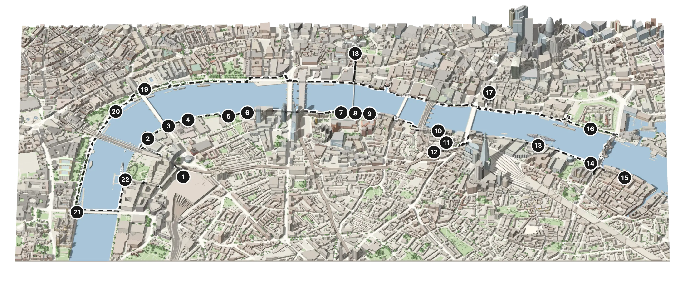

# London - Stroll along Southbank

Every time I am in London, I walk the South Bank. It started unknowingly and missing a lot of spots, since [my first visit in 2015](https://albums.oinam.com/album/london-2015may-jul/). I’d still like to repeat the walks with new addition of places and spend more time whenever I get opportunities in future.

I start at Waterloo Station, find the river, and keep it on my left all the way to Tower Bridge. That is the whole plan. No tickets to book, nothing to queue for, unless I want to. It is a few kilometers of London at walking pace.

<figure class="gallery"></figure>

The picture is a model. [Open it](/misc/london-southbank/) to turn it, tip it, and fly the walk from stop to stop, with the landmarks named as you pass.

## The Walk

1. **Waterloo Station.** Where it starts. Out of the station, and follow the signs to the river.
2. **Southbank Centre.** The Royal Festival Hall, from the 1951 Festival of Britain, and the skaters in the Undercroft.
3. **BFI Southbank.** The cinema, and the second-hand book tables under Waterloo Bridge.
4. **National Theatre.** Concrete terraces that people either love or hate.
5. **Gabriel’s Wharf.** A little cluster of shops and cafés right on the river.
6. **Oxo Tower Wharf.** Look up for the O, X, and O in the tower’s windows.
7. **Tate Modern.** The old Bankside Power Station, an art gallery since 2000.
8. **Millennium Bridge.** St Paul’s Cathedral, straight across the river.
9. **Shakespeare’s Globe.** The theater, rebuilt close to where the original stood.
10. **Golden Hinde.** A full-size replica of Sir Francis Drake’s ship.
11. **Southwark Cathedral.** One of the oldest churches in London.
12. **Borough Market.** Come hungry.
13. **HMS Belfast.** A Second World War cruiser, moored for good.
14. **Tower Bridge.** The one everyone pictures. Walk across, or just stand and look.
15. **Shad Thames.** Old warehouses, cobbles, and walkways overhead. The end of the walk.

## The Way Back

Or keep going: across Tower Bridge, and back along the north bank to where it started.

16. **Tower of London.** Nearly a thousand years old, and a fortress, a palace, and a prison in its time.
17. **The Monument.** Christopher Wren’s column to the Great Fire of 1666.
18. **St Paul’s Cathedral.** Up Peter’s Hill from the river, with the dome at the end of the street.
19. **Somerset House.** A courtyard that becomes an ice rink in winter.
20. **Cleopatra’s Needle.** An Egyptian obelisk, about 3,500 years old. It has nothing to do with Cleopatra.
21. **Big Ben.** The clock tower of the Houses of Parliament. Cross Westminster Bridge here.
22. **London Eye.** Waterloo Station is a few minutes away, and the loop is closed.
{: start="16"}
